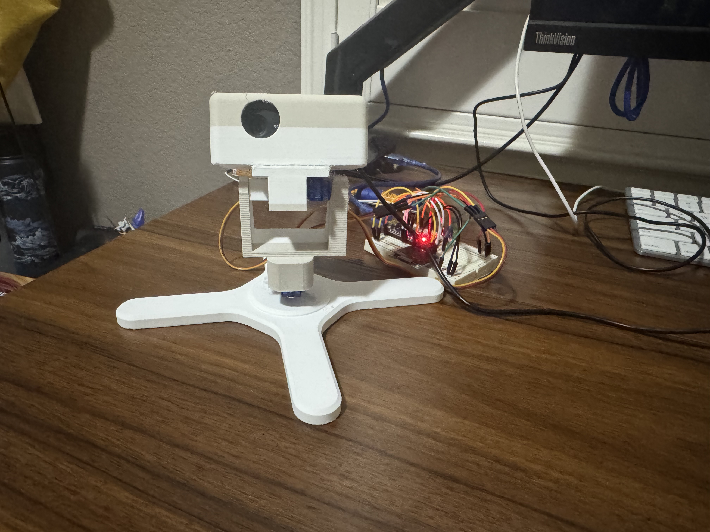
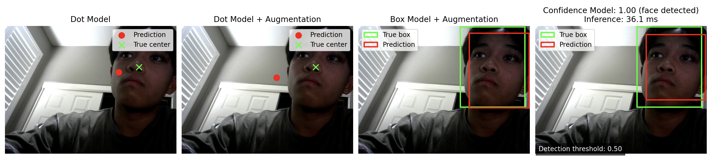

# Face Tracker — AP Personal Project

A face-tracking gimbal built with a custom-trained convolutional neural network (CNN), Python, and Arduino-controlled servos. The goal is to detect a face through a webcam and move a pan-tilt mount to follow it.

---

## Project Overview

I built and trained my own CNN to locate my face in webcam images for use in a face-tracking gimbal. I experimented with different ways of representing a face's location and investigated whether data augmentation could improve performance on images the model had not seen before.

### Goals
- Compare different approaches to face localization
- Investigate how data augmentation affects performance on unseen images
- Improve the stability and responsiveness of real-time face tracking
- Connect the vision model to a physical tracking system

---

## Repository Structure

| Path | Description |
|------|-------------|
| `models/` | Trained Keras models (`.keras`) |
| `dataset/csv_files/` | Annotation CSVs (points and bounding boxes) |
| `dataset/training_arrays/` | Preprocessed NumPy arrays used for training |
| `src/dataset_creation/` | Scripts for capturing, annotating, augmenting, and normalizing data |
| `src/model_training_files/` | Model architecture and training scripts |
| `src/evaluation/` | Offline model evaluation scripts |
| `src/arduino+webcam/` | Real-time control scripts + Arduino sketch |
| `stl/` | 3D-printable files for the pan-tilt mount and webcam holder |

---

## Methodology

### 1. Custom CNN Development

Using TensorFlow/Keras, I explored different ways to represent the location of the center of my face. I used mean squared error (MSE) as my loss function and sigmoid activation functions in my initial models.

#### Dot Model

I first trained the model using images annotated with a single point at the center of my face. This implementation showed poor results: the model tended to predict a point near the center of the screen rather than reliably locating the center of my face. When new images were added, the result improved slightly, though the true cause of its error is still unknown.

#### Bounding Box Model

I then represented the face as a bounding box instead of a single point. This allowed the model to predict a region around my face rather than just its center.

I also tested a custom implementation of Generalized Intersection over Union (GIoU) loss, but the model began predicting bounding boxes that covered the entire webcam frame.

The bounding-box model returns four coordinates:

- `x1`: Left edge  
- `y1`: Top edge  
- `x2`: Right edge  
- `y2`: Bottom edge  

These coordinates define the top-left and bottom-right corners of the bounding box. I implemented image annotation using OpenCV's `selectROI()` method. Inconsistent or inaccurate annotations may have contributed to training difficulties.

Another issue was that the model could predict a face even when none was present. To investigate this, I developed a model with an additional confidence output.

### 2. Data Augmentation

I experimented with data augmentation to see whether modified images would improve the model's accuracy on unseen images.

I implemented image transformations using OpenCV's `flip()` and `convertScaleAbs()` functions. The transformations included horizontal flipping, vertical flipping, and brightness adjustments, producing four augmented versions per original image.

For the dot model, augmentation had little effect on the measured error. This may be because the model continued to predict locations near the center of the screen. However, augmentation substantially improved the performance of the bounding-box model.

### 3. Confidence Model

I also tested a model with five outputs: four bounding-box coordinates and a confidence score between 0 and 1.

Because the webcam feed might not always contain a face, I introduced blank images labeled with a confidence score of 0. The goal was to reduce false detections by teaching the model to distinguish images containing a face from images without one.

### 4. Testing and Evaluation

I implemented model evaluation in [`evaluate_model.py`](src/evaluation/model_tests/evaluate_model.py).

I tested the dot model, augmented dot model, augmented bounding-box model, and confidence model on 17 new images that were not used during training.

The average pixel error between the predicted and expected face centers was:

| Model                        | Average Center Error |
|-----------------------------|---------------------:|
| Dot model                   | 221.06 px            |
| Augmented dot model         | 224.92 px            |
| **Augmented bounding-box model** | **67.94 px**     |
| Confidence model            | 126.39 px            |

The confidence model's average predicted confidence was **0.9129**.

The augmented bounding-box model performed best, achieving an average center error of 67.94 pixels — approximately 46% lower than the confidence model's error.

The dot model and augmented dot model showed little improvement after augmentation, consistent with their tendency to predict near the center of the screen. In contrast, the augmented bounding-box model localized the face more accurately.

Although the confidence model produced a high average confidence score, its localization error was still higher than that of the augmented bounding-box model. Since all 17 test images contained a face, this evaluation does not establish how reliably the confidence model distinguishes images with faces from images without them.

#### Limitations

The results are based on 17 test images. Although these images were new to the models, this is a relatively small evaluation set, so the measured errors may not represent performance across different lighting conditions, backgrounds, face positions, or camera distances.

The causes of the differences in performance between models require further investigation.

---

## Models

| File | Type | Notes |
|------|------|-------|
| `aug_boxes_face_turret_model.keras` | Bounding box (augmented) | Best localization performance (~68 px error) |
| `confidence_face_turret_model.keras` | Bounding box + confidence | Trained with blank images |
| `boxes_face_turret_model.keras` | Bounding box | Non-augmented baseline |
| `augmented_face_turret_model.keras` | Point | Intermediate experiments |
| `augmented_mse_face_turret_model.keras` | Point with mse loss func. | Intermediate experiments |
| `face_detection_yunet_2023mar.onnx` | OpenCV YuNet Model | Gimbal testing and annotation workflow | 

After experimenting with multiple models, I decided to use three for the final gimbal product: the augmented bounding-box model, the confidence model, and a pretrained OpenCV model (to test the accuracy of the servo control).

---

## Vision Tracking and Servo Control

### Converting Vision Tracking into Control

All of the models return a bounding box and possibly a confidence score. By calculating how far the center of the bounding box deviates from the center of the webcam frame, we can find the pixel offset, which can then be translated into pan and tilt angles. The confidence score is used to determine whether the model is hallucinating a face.

### Calculating Focal Length

The listed focal field of view of my Logitech C270 webcam is 55° diagonally; it captures video at 1280 × 960 pixels. To convert pixel offsets into viewing angles, I calculated the camera's focal length in pixel units.

First, I calculated the diagonal resolution:

$$d_p = \sqrt{1280^2 + 960^2} = 1600 \text{ pixels}$$

Using the diagonal FOV, the focal length is:

$$f = \frac{d_p / 2}{\tan(\theta_d / 2)}$$

where ($d_p$) is the diagonal pixel resolution and $\theta_d = 55^\circ$ is the diagonal FOV.

$$f = \frac{800}{\tan(27.5^\circ)} \approx 1538.6 \text{ pixels}$$

Assuming square pixels and a rectilinear camera model, this gives an estimated focal length of approximately 1539 pixels. The corresponding horizontal and vertical fields of view are approximately 45.1° and 34.7°, respectively.

Given a face center at pixel coordinates $(x_c, y_c)$, the horizontal and vertical viewing angles relative to the image center can then be estimated as:

$$\alpha_x = \tan^{-1}\left(\frac{x_c - 640}{1538.6}\right)$$

$$\alpha_y = \tan^{-1}\left(\frac{y_c - 480}{1538.6}\right)$$

These angles provide the basis for translating the face's position in the image into pan and tilt adjustments. The calculated focal length is an estimate based on the advertised FOV; actual camera calibration may differ due to lens distortion or cropping.

### Connection to Servo

To ensure that the pan & tilt movements are smooth, I added a smoothing function. In short, it translates only a quarter of the pixel offset into pan & tilt movements, which lengthens the time it takes for the camera to reach the desired position. However, because my computer does all of the preprocessing, the camera loop runs quickly.

The Arduino is connected through serial and angle offsets are sent from a 90° center, so movement in both directions is possible. The Arduino waits for a command from my computer and executes once a `\n` is sent.

---

## 3D Printing

I used Onshape CAD and my school's 3D printer to create my physical model. I used makerworld files for the gimbal base, tweaking them to match my specifications and adding a custom webcam holder. 

My first print didn't work very well. The webcam mount was a twentieth of an inch smaller than my webcam's width, which made the fit too snug. The gimbal did not allow for any tilt upwards, which was not ideal. The base was too small and caused the model to tip over.

For my second print, I fixed all of these problems. I used a spline to create a curved mounting point for the webcam and tilt motor, allowing 180 degrees of motion (which is more than enough). I expanded the base into a large x shape, which increased stability while keeping material cost relatively low. I increased the width of the webcam holder by decreasing the thickness of the side walls, adding a tenth of an inch to the webcam slot (I added a tenth to ensure fit). 

This print also had its own issues. My motors were too tall for the mount, which meant I had to drill into the 3D print and hot glue the servo horns inside. While this fix wasn't ideal, it taught me how to improvise and make do with what I have. 

Cited: https://makerworld.com/en/models/3248719-pan-tilt-camera-turret-for-9g-servos-sg90?from=search#profileId-3681538

---

## Hardware and Tools

### Hardware
- Webcam: Logitech C270
- Microcontroller: Arduino Nano (or compatible)
- Servos: SG90 (pan + tilt)
- Custom 3D-printed pan-tilt mount and webcam holder

### Software and Libraries
- Python
- TensorFlow / Keras
- OpenCV
- NumPy
- pandas
- Arduino IDE

---

## Getting Started

1. Clone the repository  
2. Install dependencies (TensorFlow, OpenCV, NumPy, pandas, pyserial)  
3. Load one of the models from the `models/` folder  
4. Run a control script from `src/arduino+webcam/`  
5. Upload `arduino_face_turret.ino` to the Arduino Nano  

## Build Process and Failures
1. Dot Model Failure:
    - The Dot Model failed to predict well because most of my initial dataset included faces near the center of the image. However, upon adding more images with my face off to the side, the model's performance failed to improve. It was okay with a semi-accurate loss score because patterns were harder to pick up with only a single point as a hotspot.
2. Annotation Problems:
    - Initial annotation was inconsistent and likely added some variance in my initial model's predictions. 
    - I used YuNet's 2023 face tracking model in hope of getting better annotation results, iterating through my list of pictures and only re-annotating images the model could not recognize a face in. This way, the model controlled the accuracy of the annotations and any annotations of mine could be more accurate, since I was basing my annotations based off the YuNet model.
3. GIoU Failure:
    - Generalized Intersection over Union is a loss strategy that aims to penalize the model for poorly creating a bounding box over the face.
    - It is better than mean squared error (mse) because it focuses on where the boxes overlap and do not overlap; mse only looks at the error between the boxes' coordinates.
    - However, because TensorFlow Addons, where it was previously stored, has been deprecated, I needed to create my own.
    - My implementation did not work; the model predicted that whole webcam frame included my face. While this is technically correct (my face IS in the camera), it isn't very helpful for tracking.
    - Even after debugging, results failed to improve, so I ended up reverting back to using MSE.
  
## Videos:
[Gimbal Movement Demonstration](https://youtu.be/ny2F1rEgIPg)
[Face Tracking Demonstration](https://youtu.be/yfMTDygsv7o)
